I have been building a personal expense tracker for the last few months. Instead of writing code, I started using AI agents while reviewing their output. This is now available on [GitHub](https://github.com/AlexITC/expense-tracker).

> Disclaimer: the code is messy and my AI workflow is far from ideal, but I'm working on both.

## Why build it

I have tried multiple apps without being satisfied with any of them. Worse yet, an app that I used for more than a year corrupted my data after an upgrade.

I want to know where my money goes and where I could save, and that requires a ledger I actually trust. So the app turns my receipts and bank statements into one.

Building it gives me the flexibility to add the features I want. I wouldn't typically have the time, but delegating to AI should resolve that.

I'm building it in public to push myself to get decent code from AI instead of accepting anything that "works", and to refine my AI workflows along the way

## Long-term goals

There are a few features I'm interested in that I hope to build eventually:

- **Chat over your data** (early version via the MCP server): ask questions in plain language, like "How much did I spend on restaurants last quarter?"
- **Saving goals** (early version): define a purchase you're saving for and track progress as you cut back on other spending.
- **Expected refunds** (drafted): register refunds you're waiting on, see what's pending, and have them matched automatically when they reach your account.
- **Subscription detector**: find recurring charges, flag price increases, and surface subscriptions you may have forgotten.
- **Warranty & return tracker**: use receipts to remind you before return windows or warranties expire.
- **Price tracking**: compare what you pay for the same items over time using receipt line items.
- **Insurance inventory**: export receipts and a report of what you own when you need to file a claim (e.g. flooding, theft).
- **Monthly digest**: an AI-written summary of your month covering what changed, what was unusual, and how your goals are going.

## Screenshots

The solid part today is data ingestion: receipts via a Telegram bot and bank statements from PDF. Everything else is early or drafted.

I can't share a live app, but here are screenshots of the current state.

### Receipts ingestion

I found myself too lazy to upload receipts from my computer, I didn't want to spend time building a mobile app.
I built a Telegram bridge so that I can take pictures of receipts and share them right away. So far, this works nicely.

Sending a receipt to the Telegram bot allows me to capture its details:
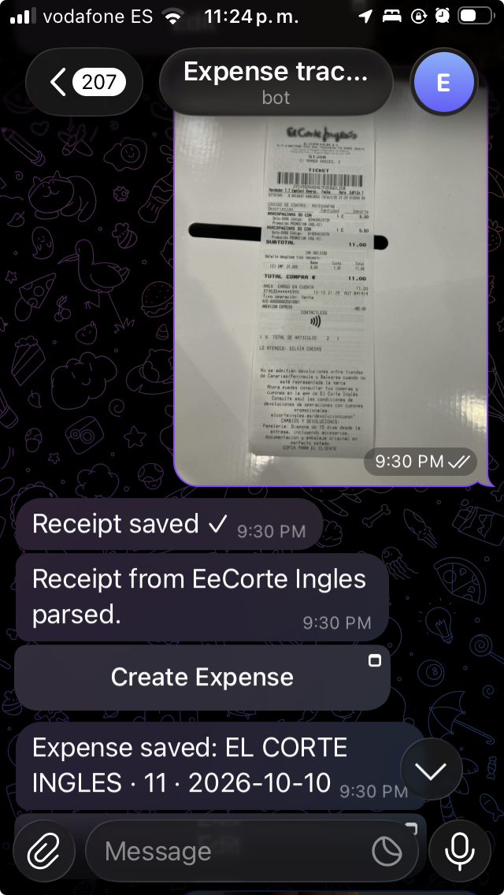

There is a mini webapp for Telegram to capture the receipt details (prefilled automatically):
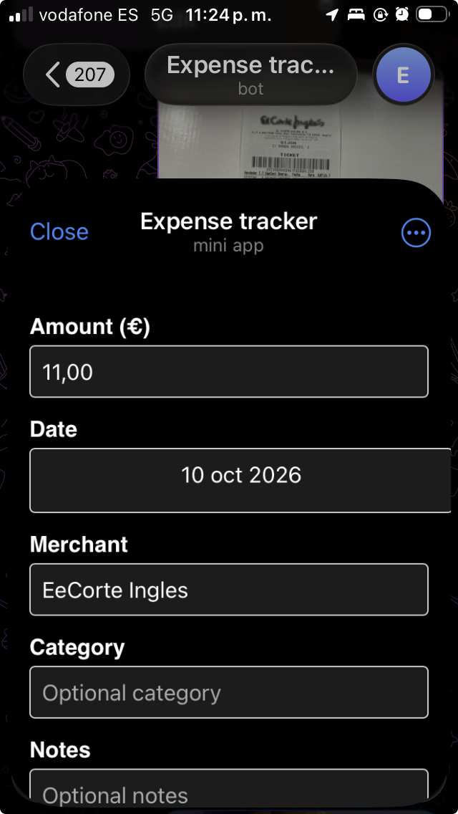

Receipts are displayed on a page:
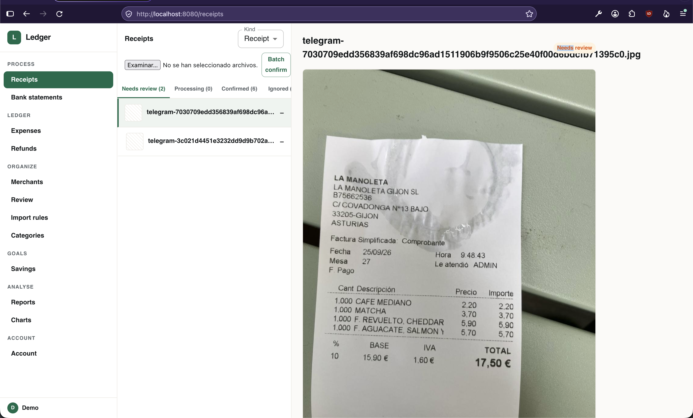

Confirming the receipt details creates an expense, which can be edited from the expenses page:
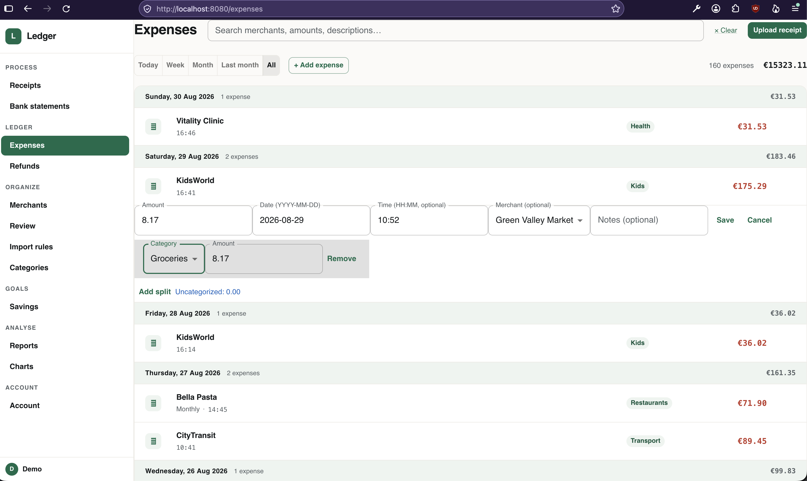

### Bank statements

I download PDF statements from my bank and upload them; the AI extracts the entries.

Initially I had parsing code for my banks but I have put considerable effort into making this process generic. There may be issues with other banks; if you find one, [open an issue](https://github.com/AlexITC/expense-tracker/issues).

This page collects the uploaded statements:
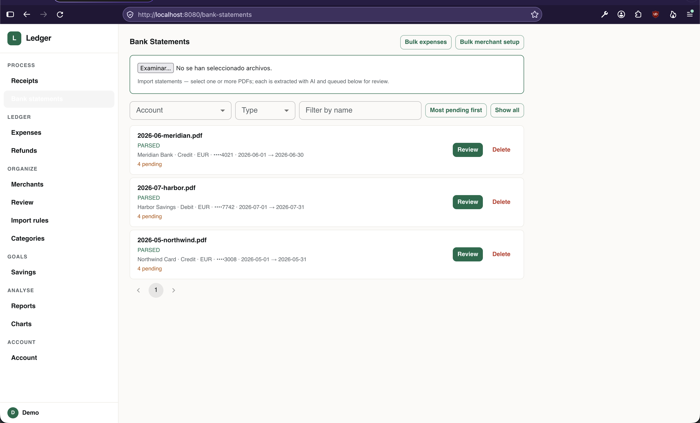

Within a statement, you can see its entries and filter them as needed:
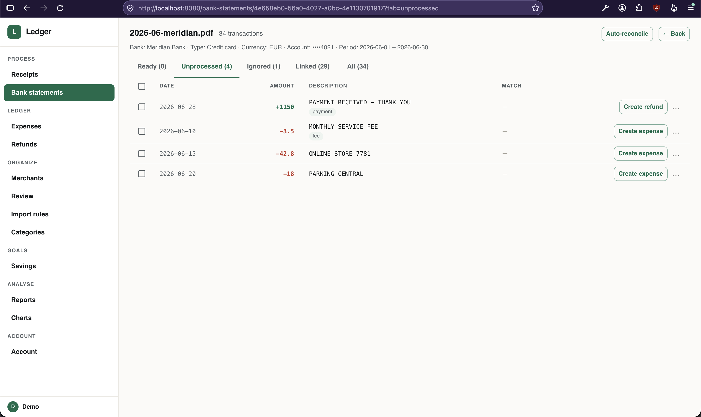

Each entry can be converted into an expense by confirming the extracted details:
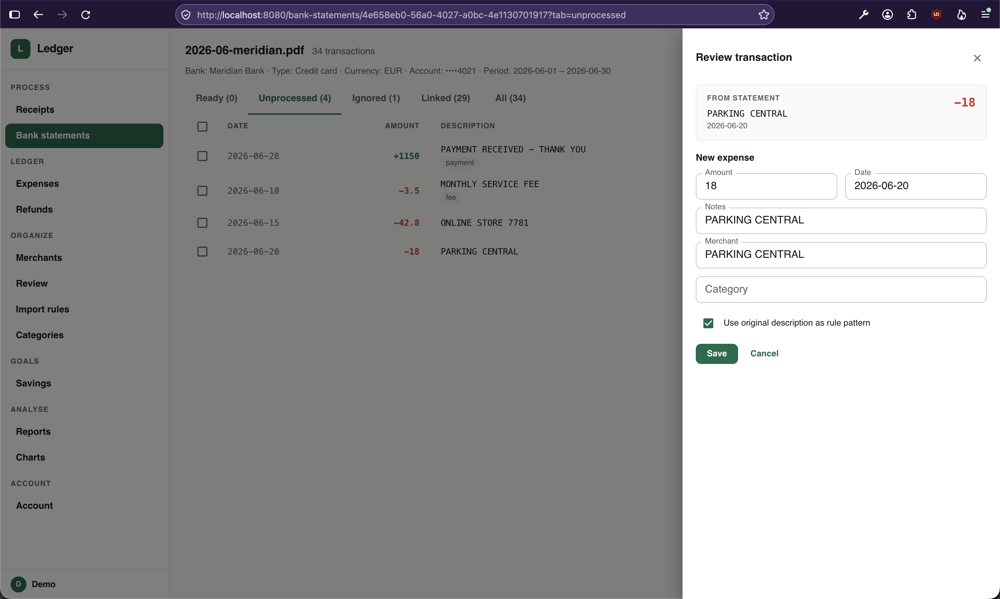

### Work in progress

There is a page for tracking refunds:
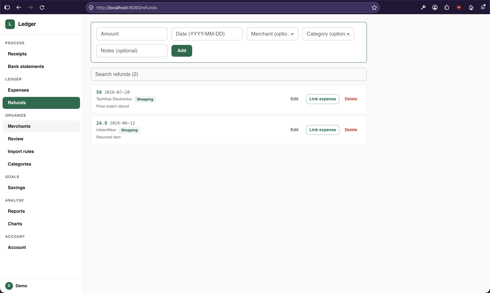

Saving goals page:
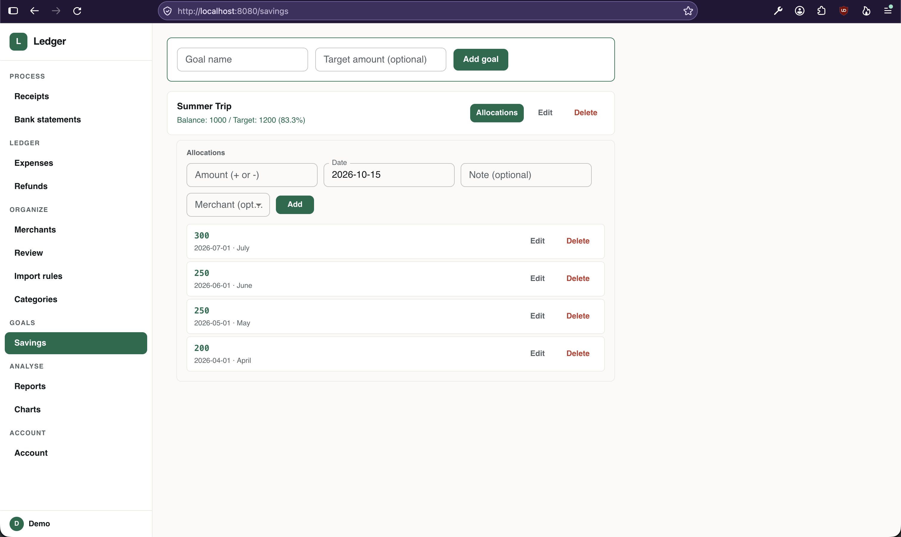

There is an experiment for bulk-creating expenses for similar-looking entries:
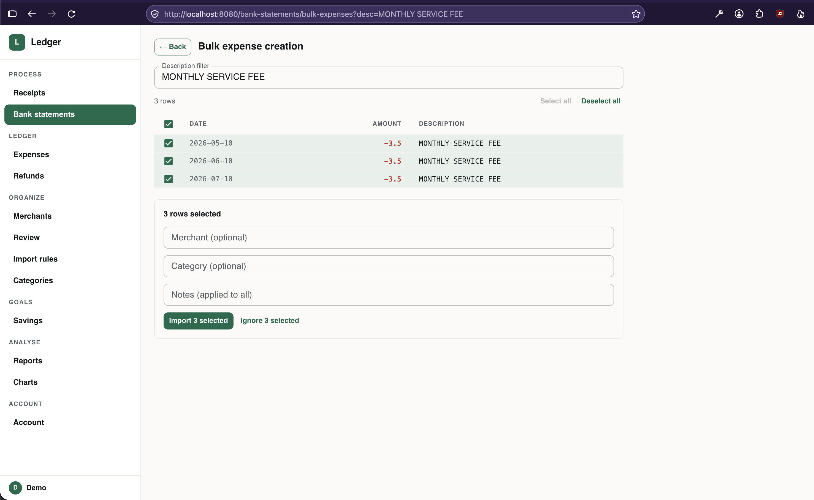

The app also has a dark mode, which I prefer:
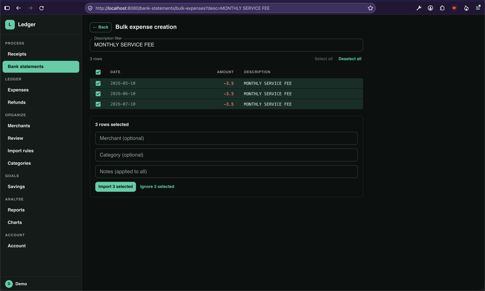

## Conclusion

I like where this is going, but only time will tell how many of these goals I'll meet.
Like everyone, I'm frustrated by repeating myself to the AI, something I'm trying to fix.

If you used an app like this, what's the killer feature you'd love to have?

The code is on [GitHub](https://github.com/AlexITC/expense-tracker).
