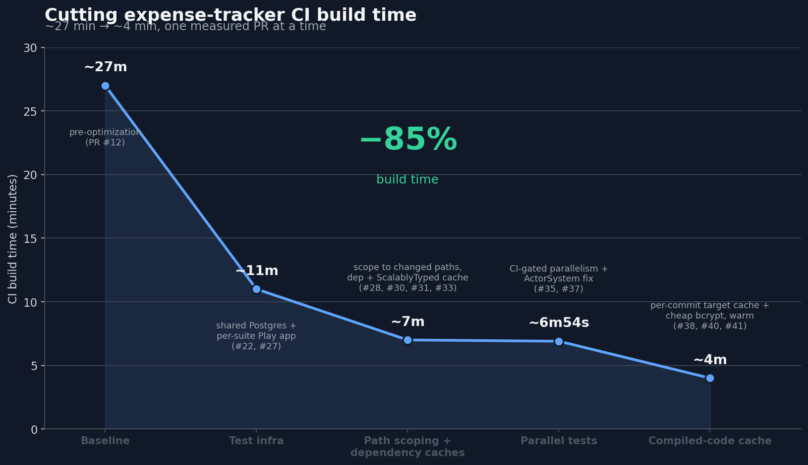

No one likes long CI times, yet it's a common problem on engineering teams. While delegating work to AI agents, I got annoyed enough to finally optimize it.

For my latest [open source project](https://github.com/AlexITC/expense-tracker), the CI execution time grew to 27 minutes per run! Of course this is an annoying bottleneck. With some effort I managed to get this down to an average of 4 minutes.

I made a list of assumptions on where I could save time and tested each one independently. I managed to get this done relatively quickly with the help of AI.

While the project I'm working on is written in Scala, the techniques are generic. The post goes over what I did (with the relevant PRs linked).


## How long is your CI?

Vote to see how everyone else's CI compares.

<iframe
  src="https://livepolls.com/p/how-long-does-your-ci-take-5z1i?embed=true&theme=dark"
  title="How long does your CI take?"
  loading="lazy"
  style="width:100%;max-width:640px;height:660px;border:1px solid #374151;border-radius:0.5rem;display:block;margin:2rem auto;"
></iframe>

> For reference, this project now sits in the 2–5m bucket.


## Initial state

Let's start by analyzing the [project](https://github.com/AlexITC/expense-tracker)'s state:

- Fullstack Scala app, 32k lines of code + 15k in tests.
- Most tests are integration tests: they run against a real Postgres container instead of mocking it, and many also boot the app to hit real endpoints.
- Out of ~1k tests, ~600 need Postgres and ~300 of those also need the app.
- The CI setup already caches what it can.

The CI checks:
- The code is properly formatted.
- The app compiles.
- The tests pass.
- The frontend runs locally (this has broken several times even when the code compiled).
- The production build works.


> Don't know why but GitHub says 25 minutes here while the summary says 27 minutes


## How it got this bad

The app started from a  I built myself. Its CI ran in under 10 minutes. Coming from enterprise environments, that seemed fine, so I left it alone. Given that I tweaked it a while ago, I assumed my own setup didn't have much room for improvement anyway.

The template leans on integration tests that need a database or the app. That's fine for a template (few endpoints, few DB interactions) whose setup favors correctness over speed:
- Each test that needs a database launches its own Postgres container (Testcontainers), from a clean state.
- Each test that needs the app boots its own instance, the same way.

Great isolation, and invisible with a handful of tests. But on a real app, that cost compounded with every feature, and the CI time climbed right along with it.


## Goals

Reduce the execution time as much as possible while:

- Avoiding considerable code changes, like migrating to Bazel or replacing Play Framework.
- Adding no new infrastructure or cost (no remote-cache backends, no external services).
- Keeping the test coverage: no dropping the expensive ones (real Postgres, real app), and no mocking away what they currently exercise for real.
- Prioritizing Pull Request CI time; a slightly slower run after merging to `main` is acceptable.


## Optimizations

Measure, don't guess. I treated each idea as a hypothesis and tested it on real CI before keeping it:



The changes were applied to these categories:

1. Unnecessary work.
2. Expensive per-test setup.
3. Parallelism.
4. Caching.


### 1. Unnecessary work

The biggest early win was simply avoiding unnecessary work.

A change to the frontend doesn't need the backend tests (and vice versa), so I classify each PR by the files it touches. That's a big win for a typical PR; in the worst case we still run everything.

A step aggregates the test results, but I only look at it when a test fails. Skipping it on successful builds saves ~30 seconds per job.

The integration tests create many accounts, and the app hashes passwords with bcrypt (slow by design). I kept real bcrypt in the tests but used the weakest cost setting, saving ~25 seconds without faking the hashing.


### 2. Booting too much, too often

Given that 60% of the tests need a database, this was an obvious target. I switched from launching a container per test to one shared container for the whole run (amazing result, **15 minutes saved**). As a side effect, I had to refactor the tests to use random data and query only what's relevant, so queries like `SELECT COUNT(*) FROM table` are gone.

About 30% of the tests need the real app, but those are grouped into 15 suites. Booting one app per suite instead of per test was trivial and cut ~70 seconds. I could share one app across all tests, but that would fight running suites in parallel (next section), and the saving is small anyway. Per-suite is isolated enough to parallelize, cheap enough not to matter.

I was booting my build tool (sbt) at least 6 times per workflow, and in my case each boot is slow (up to 30 seconds). Like Gradle, sbt has a server mode that boots once and stays running; pointing each step at it saved around a minute for minimal effort (~1 minute).


### 3. Not using the machine

CI runners have multiple cores. Running the test suite in parallel saved another 40 seconds.

I nearly threw this one away. A bug in my own code made the build hang forever once tests ran in parallel. Once I tracked that down and fixed it, parallelism still looked useless on my 2-core VM. It only paid off on the 4-core CI runner.

Measure on the machine that actually runs it.


### 4. Not caching, or caching wrong

Remember I said the template already had caching? Well, I was wrong.

The strategy wasn't ideal. Caches were keyed on the wrong thing, and every PR was saving the big caches for nothing: on GitHub Actions a cache saved on a PR branch is only visible to that PR, not to main or other PRs (see [restrictions-for-accessing-a-cache](https://docs.github.com/en/actions/reference/workflows-and-actions/dependency-caching#restrictions-for-accessing-a-cache)).

The action I relied on failed every time it tried to save. I only caught it by noticing the cache step was always slow. That step should be quick when there's nothing new to save, but it consistently took a while. Expanding its collapsed "Post" action showed the reason. Every save failed with:

```log
Warning: Failed to save: <h2>Our services aren't available right now</h2><p>We're working to restore all services as soon as possible. Please check back soon.</p>...
```

So the cache was never persisted; every run re-did the work it was supposed to skip.

I reworked it into three caches:

- Compiled artifacts, restored from the latest main (~2 minutes). Only main saves them; PRs skip the upload, saving another ~30s.
- Dependencies, the save that was actually broken (~30s).
- Generated code (ScalablyTyped facades, Scala-specific), ~20s.


## What's next

The ceiling from here is a remote build cache: sharing compiled output across machines and PRs, not just within a single runner. The build tool's next major version (sbt 2.0) supports it with standard cache backends but that requires a caching backend.

I'm skipping:

- A full Bazel migration would get the same remote-cache benefit for far more cost.
- Splitting the workflow into several parallel jobs would cut wall-clock time, but at 4 minutes it isn't worth it, since each job starts fresh and repeats the shared setup (checkout, dependencies, compile), costing more CI minutes for little gain.


## CI speedups

| PR | Change | Time saved | Measured on |
|----|--------|-----------:|-------------|
| [#22](https://github.com/AlexITC/expense-tracker/pull/22) | Share one Postgres container across the whole suite | ~15 min (est.) | per-test container -> one shared; with #27, took `sbt test` from ~20m to <5m |
| [#25](https://github.com/AlexITC/expense-tracker/pull/25) | Reuse one warm build server (sbt thin client) instead of re-booting per step | ~1 min (est.) | ~6 sbt boots -> 2; avoids repeated cold start |
| [#27](https://github.com/AlexITC/expense-tracker/pull/27) | Boot one Play app per suite instead of per *test* | ~70s | server test step (183s -> 113s) |
| [#28](https://github.com/AlexITC/expense-tracker/pull/28) | Scope tests/builds to the changed paths | ~20–40s | only when a PR touches one side (web- or server-only) |
| [#30](https://github.com/AlexITC/expense-tracker/pull/30) | Cache resolved dependencies | ~28s | first sbt step (78s -> 50s) |
| [#31](https://github.com/AlexITC/expense-tracker/pull/31) | Cache generated frontend type definitions (ScalablyTyped) | ~21s | first sbt step (50s -> 29s) |
| [#33](https://github.com/AlexITC/expense-tracker/pull/33) | Replace a cache step that ran but never persisted | ~29s | removed wasted "Post Setup Scala" step |
| [#37](https://github.com/AlexITC/expense-tracker/pull/37) | Run tests in parallel, scaled to CI cores | ~43s | server test step (122s -> 79s) |
| [#38](https://github.com/AlexITC/expense-tracker/pull/38) | Use real bcrypt at the cheapest cost in tests | ~25s | HTTP-level test suite (59s -> 34s) |
| [#39](https://github.com/AlexITC/expense-tracker/pull/39) | Render the test-results report only when a build fails | ~30s | every green run |
| [#40](https://github.com/AlexITC/expense-tracker/pull/40) | Cache compiled output, refreshed from main; PRs restore only | ~100s | warm PR build (4m32s -> 2m52s) |


*Numbers are measured at different scopes (test step, first-sbt step, full PR build, green-run) and aren't additive; the end-to-end result is ~27 min -> ~4 min (~85%). #22 and #25 weren't isolated in a single before/after, so their figures are estimates.*


## Conclusion

Same tests, same app, a fraction of the time. None of it was complicated. I listed every suspected slowdown, measured each fix on real CI, and kept the ones that paid off.

Here are the build details after all the changes:


I've since backported these fixes to the [template](https://github.com/wiringbits/scala-webapp-template), so new projects start with a fast CI instead of inheriting the slow one.

If your CI feels slow, most of the time is probably going somewhere boring and measurable. Go find it.

---

*I took this project's CI from ~27 minutes to ~4, one measured change at a time. I do contract work doing the same for other teams' build and CI pipelines ([alexis.ci@alexitc.com](mailto:alexis.ci@alexitc.com)).*
