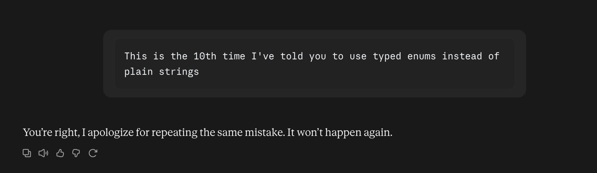
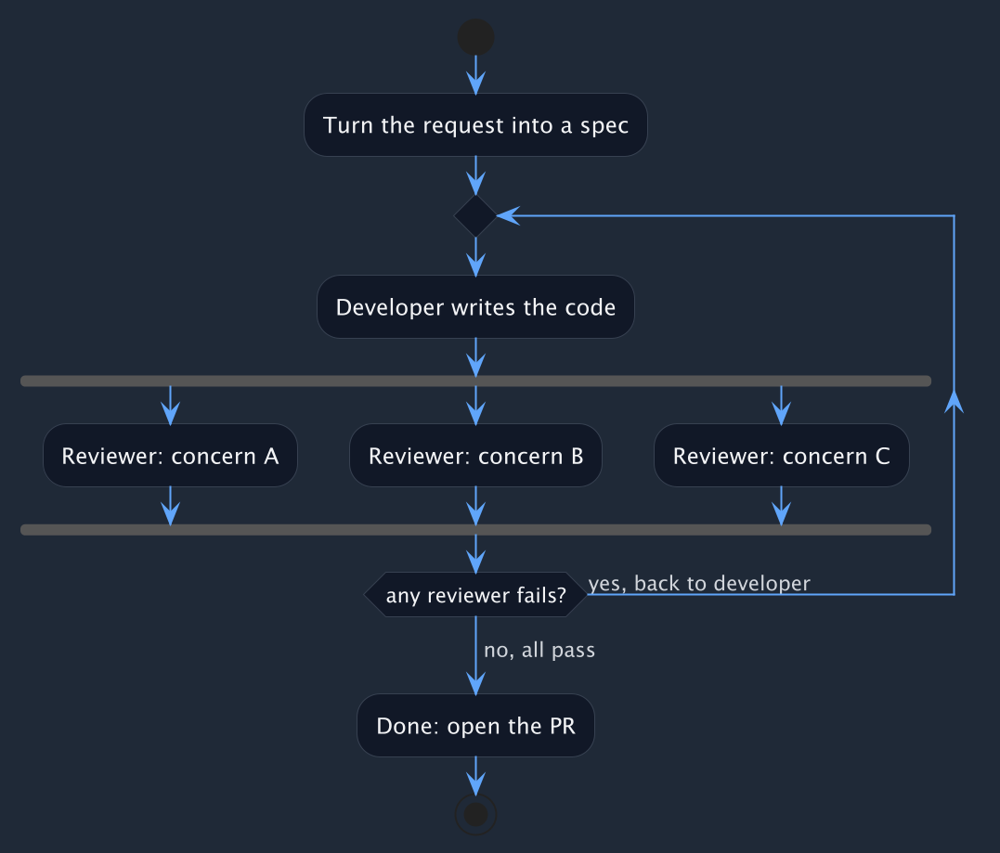

Does this sound familiar? That's what coding with AI looks like when you actually care about the code it produces:




Working with an AI agent can feel like working with a junior who ships as fast as possible without caring whether the code is good. While a junior improves over time, an agent can ignore the same instruction ten times in the same conversation.

The usual move is to write these rules into `CLAUDE.md` or a skill. It isn't enough; those are suggestions the model is free to ignore, not gates.

So I stopped repeating myself and found a way to enforce the rules instead. I call these "reviewer-gates": strict checks that block the agent from marking work as complete until they pass. When I catch a new offending pattern, I don't argue with the agent. I add a rule, and it never gets through again.

By now I have 50+ PRs built this way where I'm very satisfied with the result.


## How closely do you review AI-written code?

Before you read on, where do you stand?

<iframe
  src="https://livepolls.com/p/when-an-ai-agent-writes-your-code-how-closely-do-you-review-?embed=true&theme=dark"
  title="When an AI agent writes your code, how closely do you review it?"
  loading="lazy"
  style="width:100%;max-width:640px;height:520px;border:1px solid #374151;border-radius:0.5rem;display:block;margin:2rem auto;"
></iframe>


## The workflow

My goal was to turn a request into a spec, hand it to a developer, and refuse to call the work “done” until a set of reviewers pass.



A reviewer file covers one area and holds many rules (coding patterns, frontend, database, etc). A new file adds an area/reviewer. A new rule is usually a new section in an existing file.

Each reviewer runs as its own agent. A dedicated reviewer with a single job beats asking the developer agent to review its own work. It brings fresh context, an adversarial stance, and no incentive to defend code it just wrote.

The way I run it is by describing what I want to a Claude Code session that can read my code, so the spec is grounded in what’s actually there. Then [Orca](https://orca.virtuslab.com/latest/) (a headless plan-code-review CLI) runs the developer-and-reviewers loop. It does exactly this out of the box, with reviewers as plain Markdown files. Its flows are written in Scala, so it drops cleanly into my stack (Orca itself is language-agnostic, and the reviewers are just rules).

## What a rule looks like

Take the enum complaint from the top. Instead of repeating it, I wrote a reviewer for it once:

```markdown
---
description: Domain values that are one of a fixed set are typed enums, not bare `String`s
files: server/src/main/scala/net/wiringbits/.+\.scala
---

A domain value whose set of valid cases is fixed and known (status, kind, role,
mode, type) should be a typed enum. The compiler then rejects invalid values and
keeps exhaustive matches honest.

**Flag** a new `String` field, parameter, or return type in the domain model whose
value is really one of such a closed set, and a place that matches on its contents
with string literals instead of enum cases.

Not: free-form text (names, descriptions, messages), or identifiers that happen to
be strings (ids, keys, tokens).
```

Now the gate catches it before I ever open the PR, and further down I’ll show how to derive rules like this from your own PR history.


## How I organize and run them

Each reviewer is one Markdown file under [`.orca/reviewers`](https://github.com/AlexITC/expense-tracker/tree/main/.orca/reviewers), scoped by its `files` pattern so it only runs on the changes it cares about. Adding a rule means dropping in another file, nothing else.

I don't run Orca by hand either. A small script, [`claude/implement.sc`](https://github.com/AlexITC/expense-tracker/blob/main/claude/implement.sc), drives the loop, and I let a Claude Code session dispatch it. In practice I describe the feature to Claude, and Claude kicks off the developer-and-reviewers run for me.

## The catch is speed

Every PR now takes 30 to 120 minutes. That annoyed me at first, until I changed how I work around it:

- I dispatch several features concurrently instead of babysitting one.
- Those minutes are better spent elsewhere than reviewing code I’d reject anyway (which can be exhausting).

It’s a real trade, so it’s worth being honest about when it pays off. Reviewer-gates earn their cost on a long-lived codebase where you keep re-asserting the same opinions. For a throwaway prototype or a small bugfix, I skip them (the overhead isn’t worth it).

*Ideas to optimize the speed are welcome*


## See it in action

Here is the whole loop running on real work. I ship two features this way, and in the second I hit a couple of new offending patterns and encode them into new reviewer rules on the spot.

<div style="position:relative;max-width:720px;margin:2rem auto;aspect-ratio:16/9">
<iframe src="https://www.youtube-nocookie.com/embed/nMIsIi6mdWo" title="Reviewer-gates demo" loading="lazy" allowfullscreen style="position:absolute;inset:0;width:100%;height:100%;border:1px solid #374151;border-radius:0.5rem"></iframe>
</div>

> Remember I said this takes a while? I skipped the wait times in the video.

The resulting PRs:

- Feature 1: [#48](https://github.com/AlexITC/expense-tracker/pull/48)
- Feature 2: [#49](https://github.com/AlexITC/expense-tracker/pull/49)
- Workflow improvement, not in the video: [#50](https://github.com/AlexITC/expense-tracker/pull/50)

## Bootstrap reviewers from your PR history

You don't have to write every reviewer by hand. If your repo already has a solid history of human review comments, this prompt points an agent at it, mines the conventions your reviewers actually enforced, and writes a starting set of reviewer files. It takes a few minutes, and the patterns are useful even if you don't adopt the whole approach.

A note on where these came from. The reviewer files linked in this post weren't generated. That project has no team or PR history to mine, so I added each rule by hand the first time a Claude PR committed the offense. The prompt below instead reads a repo's existing PR review history and drafts reviewer rules from the feedback that keeps recurring. I built it with Claude and tuned it against repos I own that do have real reviews.

<details style="margin:2rem 0;border:1px solid #374151;border-radius:0.5rem;background:#1f2937;overflow:hidden">
<summary style="cursor:pointer;padding:0.9rem 1.1rem;font-weight:600;color:#f3f4f6">Show the prompt</summary>
<div style="padding:0 1.1rem 1.1rem">
<button type="button" data-prompt-copy="prompt-src" aria-label="Copy the prompt to your clipboard" style="display:inline-flex;align-items:center;gap:7px;margin:0.25rem 0 0.9rem;font-size:0.85rem;background:#2563eb;border:0;color:#fff;padding:8px 14px;border-radius:8px;cursor:pointer;font-family:inherit">
<svg width="14" height="14" viewBox="0 0 24 24" fill="currentColor" aria-hidden="true"><path d="M16 1H4c-1.1 0-2 .9-2 2v14h2V3h12V1zm3 4H8c-1.1 0-2 .9-2 2v14c0 1.1.9 2 2 2h11c1.1 0 2-.9 2-2V7c0-1.1-.9-2-2-2zm0 16H8V7h11v14z"/></svg>
<span data-label aria-live="polite">Copy prompt</span>
</button>
<noscript><p style="font-size:0.85rem;color:#9ca3af">Enable JavaScript to view and copy the prompt, or read it in the post source.</p></noscript>
<pre style="margin:0;max-height:24rem;overflow:auto"><code id="prompt-code" style="white-space:pre-wrap"></code></pre>
</div>
</details>

<script type="text/plain" id="prompt-src">
Generate Orca reviewer files for a GitHub repository by mining the conventions its
reviewers actually enforce in pull-request comments.

Figure out which repository to work on from the current context — you're most likely
already inside the project:

```bash
REPO=$(gh repo view --json nameWithOwner -q .nameWithOwner)   # e.g. from the git remote
OWNER=${REPO%%/*}; NAME=${REPO#*/}
echo "$REPO"
```

If that comes back empty (no remote, not a repo, several candidates), ask me which
repository you mean rather than guessing. Make sure you can read its pull requests
through the GitHub API — I'll help you sort out authentication if `gh auth status` isn't
already good. Everything below uses `gh` and `jq`.

The source of truth is **human review comments on merged PRs** — nothing else. Not the
code, not the docs, not the README. A good reviewer rule is a convention a human kept
asking other humans to follow.

Work in a scratch directory and follow one rule throughout: **do the I/O in shell, keep
the raw JSON out of your context.** Write every API response to a file and read back
only reduced, comment-level slices. If a raw PR payload would land in your context,
you've done it wrong.

## Step 1 — Short-circuit: is there enough review history?
Page every merged PR, counts only (no bodies), and count the ones that carry real human
review discussion:

```bash
cursor=null; : > pr_counts.jsonl
while : ; do
  resp=$(gh api graphql -f query='
    query($o:String!,$r:String!,$c:String){
      repository(owner:$o,name:$r){
        pullRequests(states:MERGED, first:100, after:$c, orderBy:{field:CREATED_AT, direction:DESC}){
          pageInfo{ hasNextPage endCursor }
          nodes{ number author{login} reviewThreads{totalCount} }
        }}}' -F o="$OWNER" -F r="$NAME" -F c="$cursor")
  echo "$resp" | jq -c '.data.repository.pullRequests.nodes[]?' >> pr_counts.jsonl
  page=.data.repository.pullRequests.pageInfo
  [ "$(echo "$resp" | jq -r "$page.hasNextPage")" = true ] || break
  cursor=$(echo "$resp" | jq -r "$page.endCursor")
done

# non-bot PRs with at least one inline review thread
jq -r 'select((.author.login|test("bot$|steward|dependabot|renovate";"i"))|not)
       | select(.reviewThreads.totalCount >= 1) | .number' pr_counts.jsonl \
  | sort -un > reviewed_prs.txt
wc -l < reviewed_prs.txt
```

If fewer than ~20 PRs clear that bar, **stop**: this repo doesn't have enough review
history to mine conventions from, and reviewers are better written by hand. Report the
number and don't fabricate rules from a handful of comments.

## Step 2 — Harvest the comments (bodies + the code they point at)
For each reviewed PR, pull the inline review comments with their diff hunk — the inline
comments anchored to a line are the prescriptive ones; that is all you need:

```bash
: > comments.jsonl
while read -r pr; do
  gh api --paginate "repos/$REPO/pulls/$pr/comments" \
    --jq ".[] | {pr: $pr, path: .path, author: .user.login, body: .body, hunk: .diff_hunk}" \
    >> comments.jsonl
done < reviewed_prs.txt
```

Reduce: drop bot authors, drop bodies under ~12 chars and pure acknowledgements, strip
carriage returns, and trim each hunk to its last ~500 chars; then split by length:

```bash
jq -c '
  select((.author // "" | test("bot$|steward|dependabot|renovate";"i")) | not)
  | .body |= gsub("\r"; "")
  | select((.body | length) >= 12)
  | select((.body | ascii_downcase
      | test("^\\s*(lgtm|done|thanks?|thank you|nit|fixed|ok(ay)?|agreed?|same|ditto|good|great|makes sense)\\.?\\s*$") | not))
  | {pr, path, author, body, hunk: (if (.hunk | length) > 500 then .hunk[-500:] else .hunk end)}
' comments.jsonl > reduced.jsonl

jq -c 'select((.body | length) >= 120)'            reduced.jsonl > substantive.jsonl
jq -c 'select((.body | length) <  120) | {pr,path,body}' reduced.jsonl > short.jsonl
wc -l reduced.jsonl substantive.jsonl short.jsonl
```

Then print a quick term-frequency and distinct-PR count over `reduced.jsonl` to orient
yourself before reading.

## Step 3 — Read everything and cluster by concern
Read the reduced comments **in full** — substantive-with-hunks first, then the short
bodies; page large files, don't sample. The short bucket will still contain some thread
chatter the acknowledgement filter missed (multi-word or multi-language approvals like
"ok, as discussed", "true, thanks") — skip anything conversational; a convention is an
instruction to change code, not a reply. As you read, group comments into **concerns** —
the recurring themes a reviewer would own. Do not decide the concerns in advance and do
not derive them from the repo's folder layout; let them emerge from what reviewers
actually complain about. A concern may be a cross-cutting idiom that shows up everywhere,
a rule tied to one kind of file, or a process expectation — whatever the comments show.

Judgment rules:
- **State the principle, not the instance.** Each rule describes a general pattern to
  look for; if its wording only makes sense for the one function it came from, abstract
  it further. Reviewers read diffs, so a rule says what to flag and why.
- **A convention earns a rule even if it appears once**, as long as it generalizes.
  Frequency only ranks rules and merges duplicates; it never gates. Discard only
  comments whose point is specific to a single place and generalizes to nothing.
- **Aim for a handful of concerns.** Let them emerge, but a reviewer file holds several
  related rules — don't spin up a file per rule. Merge a thin concern into the nearest
  larger one unless its single rule clearly stands on its own.

## Step 4 — Scope each concern
Now, and only now, look at the repository's structure to place each concern — list the
tree and the top-level modules so you know where each kind of file lives. This is for
placement only: it must not change which concerns exist or merge/split them. The
concerns stay exactly as the comments defined them.

For each concern, take the `path`s of its own comments as a sample of where the rule
applies, then generalize to a `files:` glob covering that *kind* of file across the
whole repo — not just the files that happened to get a comment. A concern whose comments
are spread across the tree gets a broad glob; one whose comments cluster in a module
gets a glob scoped to that module's real boundary. Err toward the module boundary the
comments point at: don't widen a layer-specific concern to the whole tree, and don't
narrow a cross-cutting one to the handful of files that drew comments.

Globs will overlap, and that is fine — a cross-cutting concern (error handling, naming,
logging) and a layer concern can both match the same files, so a file is reviewed by
several reviewers. Don't distort the concerns to make their globs disjoint. If one rule
genuinely spans two globs, place it in the reviewer where most of its comments live
rather than duplicating it.

Write `files:` in the dialect your Orca actually supports — don't assume `**` or
`{a,b}` brace-expansion works. If the repo already has `.orca/reviewers/*.md`, copy
their `files:` style exactly. Otherwise use a comma-separated list of plain path
prefixes (the common form), e.g. `files: server/src/main, lib/api`. A concern that spans
several unrelated locations or file types becomes a list of prefixes, not one fancy
glob.

## Step 5 — Write the reviewers
Write one `.orca/reviewers/<concern>.md` per concern:

```markdown
---
description: <one line naming the concern>
files: <path pattern chosen in step 4>
---

Review changes under `<area>`.

## <imperative heading stating the principle>
<1–3 sentences: what to flag and the reason.>

Not: <the legitimate cases a reviewer must NOT flag — derive these from reviewers'
own "this is fine because…" replies, so the rule doesn't fire on false positives.>
```

Give each rule one short real example lifted from a comment's diff hunk. Order rules
within a file by how many distinct PRs raised them.

## Output
Write the `.orca/reviewers/*.md` files into the repo and give me a short report: the
concerns you found, the distinct-PR count behind each rule, an explicit list of any rule
you promoted from a single comment so I can confirm it, and who the comments came from
(the top few reviewers by volume) — if one person wrote most of them, these reviewers
encode that person's house style rather than a team consensus, which is worth knowing.

Then offer to open a pull request with these files — but don't block on it. Ask me
whether I want (a) the files left in the working tree to review myself, or (b) a PR
raised on a new branch. Only open the PR if I pick it and it's actually possible (clean
enough tree, push access); otherwise just leave the files and say so. Never commit to
the default branch directly.
</script>

<script>
  (function () {
    var src = document.getElementById("prompt-src");
    if (!src) return;
    var text = src.textContent;
    var code = document.getElementById("prompt-code");
    if (code) code.textContent = text;
    var btn = document.querySelector('[data-prompt-copy="prompt-src"]');
    if (!btn) return;
    var label = btn.querySelector("[data-label]");
    btn.addEventListener("click", async function () {
      var ok = false;
      try {
        await navigator.clipboard.writeText(text);
        ok = true;
      } catch (e) {
        try {
          var ta = document.createElement("textarea");
          ta.value = text;
          ta.style.position = "fixed";
          ta.style.opacity = "0";
          document.body.appendChild(ta);
          ta.focus();
          ta.select();
          ok = document.execCommand("copy");
          document.body.removeChild(ta);
        } catch (e2) {
          ok = false;
        }
      }
      if (label) {
        var prev = label.textContent;
        label.textContent = ok ? "Copied" : "Press Ctrl+C to copy";
        setTimeout(function () {
          label.textContent = prev;
        }, 1500);
      }
    });
  })();
</script>


## Conclusion

These reviewer-gates turn "please stop doing that" into a rule the agent can't talk its way past. It's the same loop you'd run with a junior, except the feedback sticks the first time, because it's code, not conversation.

The price is speed, and I pay it gladly. My attention moves off spotting the same silly issues and onto the work that actually needs a human.
